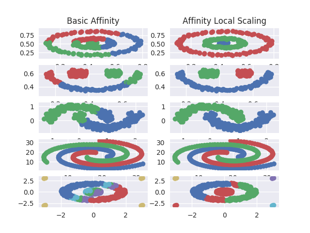

# spectral-clustering
Python implementation of the spectral clustering algorithm.



## Cite

If you found this useful, consider citing it as:

```bibtex
@misc{spectral-clustering,
  author = {Manuel Pineda},
  title = {Spectral clustering in Python},
  year = {2017},
  publisher = {GitHub},
  url = {https://github.com/pin3da/spectral-clustering/}
}
```

----

[Manuel Pineda](https://github.com/pin3da)
